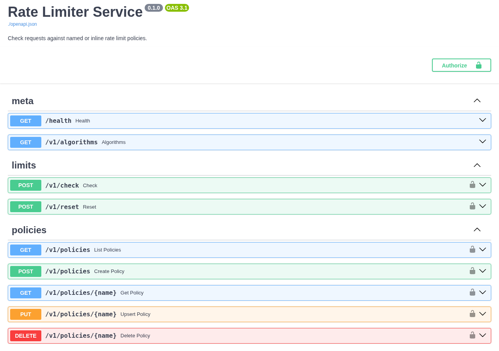
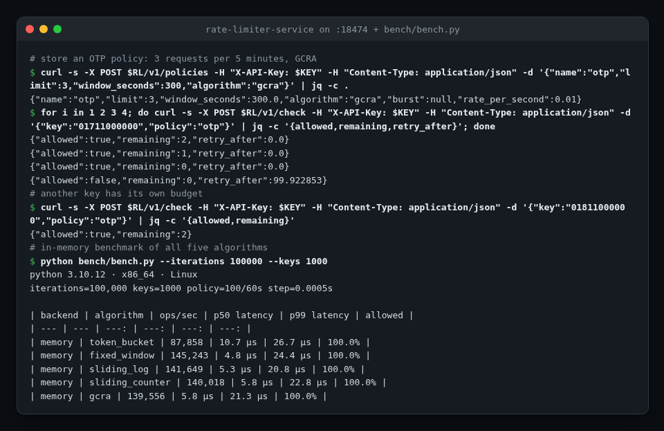
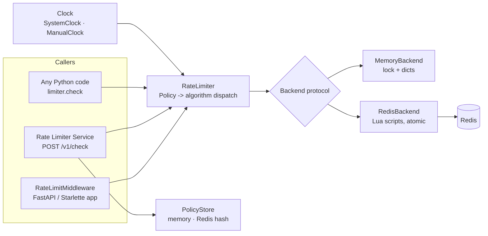

<!-- topics: rate-limiting,token-bucket,sliding-window,gcra,redis,lua,fastapi,python,middleware -->
# Rate Limiter Service

Distributed rate limiting as a library, an ASGI middleware and a standalone service: five algorithms (token bucket, fixed window, sliding log, sliding window counter, GCRA) over in-memory or Redis backends, with time injected so every behaviour is testable without sleeping.

[](https://github.com/AkibUllah/rate-limiter-service/actions/workflows/ci.yml)
[](https://github.com/AkibUllah/rate-limiter-service/actions/workflows/codeql.yml)
[](https://github.com/AkibUllah/rate-limiter-service/releases)


## Try it live

| | |
|---|---|
| API reference | https://akibullah.github.io/rate-limiter-service/ — Swagger UI built from the exported OpenAPI document (static; no backend behind it) |
| Run in your browser | [](https://codespaces.new/AkibUllah/rate-limiter-service?quickstart=1) — starts two Redis-backed replicas with `docker compose` and seeds an `otp` policy (5 per 5 minutes); open forwarded port 8000 at `/docs` and call `POST /v1/check` a few times. |
| One-click deploy | [](https://render.com/deploy?repo=https://github.com/AkibUllah/rate-limiter-service) — `render.yaml` provisions the web service and a free Key Value store; `API_KEY` is generated, send it as `X-API-Key` on `/v1/*`. |
| Local | `docker compose up` (see Quick Start) |

## Screenshots



Live API reference on GitHub Pages: check, reset and policy CRUD endpoints.



A real run: an OTP policy (3 per 5 minutes, GCRA) denying the fourth request with `retry_after`, a second key with its own budget, and the in-memory benchmark for all five algorithms.

## Why this exists

Payment APIs get hammered by retry storms, OTP endpoints get brute-forced, and a cloud control plane has to keep one noisy tenant from starving the rest. Each time, the first version is a dict in one process; the second version moves it to Redis and discovers that `GET`, compute, `SET` is not atomic under load. This repo is the version I want to start from: algorithms separated from storage, Redis operations done in Lua so they are atomic across instances, a middleware that sets the standard `X-RateLimit-*` headers, and a service for callers that are not Python.

## Features

- `ratelimiter` package with five algorithms behind one `Policy` type: `token_bucket`, `fixed_window`, `sliding_log`, `sliding_counter`, `gcra`
- Backends behind a small protocol: `MemoryBackend` (single process, lock-protected) and `RedisBackend` (one Lua script per algorithm, atomic read-modify-write, TTLs on every key)
- Policy strings such as `100/minute`, `10/5s`, `1000/hour;algorithm=gcra;burst=50`
- Weighted requests (`cost=5`), per-policy key scoping, explicit `reset`
- `Decision` objects carrying `allowed`, `remaining`, `retry_after`, `reset_after` and ready-made HTTP headers
- Pure ASGI `RateLimitMiddleware` for FastAPI/Starlette: `X-RateLimit-Limit/Remaining/Reset`, `429` with `Retry-After`, IP or header keys, per-request policy selection, exempt paths, hooks
- FastAPI service: `POST /v1/check` with named or inline policies, policy CRUD (stored in memory or in a Redis hash shared by all instances), `POST /v1/reset`, `/health`, optional API key, and the middleware guarding the service itself
- Read-only inspection: `RateLimiter.peek()` and `GET /v1/inspect` report remaining budget, `retry_after` and `reset_after` for a key without consuming anything (dry-run Lua scripts on Redis that never write, never prune and never touch TTLs)
- Prometheus metrics at `/metrics`: `ratelimiter_decisions_total{policy,algorithm,outcome}` and a `ratelimiter_backend_latency_seconds{backend,algorithm}` histogram, one registry per app
- Injectable clock (`ManualClock`) so tests and benchmarks move time deterministically
- Only accepted requests consume quota, so a client that keeps retrying while limited is not pushed further into the future
- Benchmark script with real numbers below

## Architecture



Key decisions:

- **Algorithm logic lives in the backend, dispatch lives in the limiter.** Each backend implements five primitive operations that take `now` and return `(allowed, remaining, retry_after, reset_after)`. The Python and Lua implementations are line-for-line equivalents, and the same test-suite runs against both (via `fakeredis[lua]`).
- **Time is a parameter.** The limiter reads one clock and passes the timestamp into the backend; Redis never calls `TIME`. That makes behaviour deterministic under test and keeps instances with the same wall clock in agreement.
- **Atomicity via Lua.** Every Redis step is a single `EVALSHA`, so two instances racing on the same key cannot both see "one slot left". Floats come back as strings because Redis truncates Lua numbers.
- **Accepted requests consume, denied ones do not.** A denied request leaves the state untouched; `retry_after` tells the caller exactly when the next unit frees up.
- **Inspection runs the same code path.** `peek` is the same backend step with a `dry_run` flag, so what `/v1/inspect` reports is exactly what the next `/v1/check` would decide. On Redis the sliding-log dry run skips expired entries by rank (`ZCOUNT` + `ZRANGE`) instead of deleting them, so a peek is a pure read.
- **Pure ASGI middleware.** No `BaseHTTPMiddleware`, so streaming responses work and the per-request overhead is a dictionary lookup for the memory backend; Redis calls are offloaded to a thread so they do not block the event loop.

## Algorithms

| Algorithm | State per key | Boundary behaviour | Best for |
| --- | --- | --- | --- |
| `fixed_window` | one counter | allows up to 2x `limit` across a window edge | cheap quotas, coarse limits |
| `sliding_log` | sorted set of timestamps | exact | small limits that must be precise (login, OTP) |
| `sliding_counter` | current + previous counters | near-exact (weighted estimate) | general API limits |
| `token_bucket` | tokens + last refill | smooth; `burst` controls spikes | public APIs that should allow short bursts |
| `gcra` | one timestamp (TAT) | exact spacing with `burst` allowance | high-rate limits where memory matters |

## Benchmark

`bench/bench.py` runs every algorithm against the in-memory backend with a manual clock: 200,000 checks spread over 1,000 keys under a `100/60s` policy, one check every 0.5 ms of simulated time. Numbers below are from a real run on this machine (Python 3.10.12, x86_64 Linux, 4 shared cores):

| backend | algorithm | ops/sec | p50 latency | p99 latency | allowed |
| --- | --- | ---: | ---: | ---: | ---: |
| memory | token_bucket | 152,303 | 5.7 µs | 21.4 µs | 100.0% |
| memory | fixed_window | 193,360 | 4.6 µs | 18.5 µs | 90.0% |
| memory | sliding_log | 176,800 | 5.1 µs | 18.5 µs | 89.5% |
| memory | sliding_counter | 150,400 | 5.6 µs | 20.3 µs | 89.5% |
| memory | gcra | 159,669 | 5.7 µs | 20.7 µs | 100.0% |

Reading the table: window algorithms cap each key at 100 per window (120 arrive per simulated minute, so ~90% pass), while token bucket and GCRA start with a full 100-unit burst that this load never drains, so everything passes. All algorithms are within a factor of ~1.3 of each other; the limiter itself is far from being the bottleneck of an HTTP request. Pass `--redis redis://localhost:6379/0` to add rows for the Lua backend (network round-trip dominated).

```bash
make bench   # or: python bench/bench.py --iterations 200000 --keys 1000
```

## Tech Stack

| Layer | Choice |
| --- | --- |
| Library | Python 3.10+, dataclasses, `typing.Protocol` |
| Storage | in-process dicts; Redis 7 via `redis-py` with Lua scripts |
| Service | FastAPI, Pydantic v2, pydantic-settings, uvicorn |
| Observability | prometheus-client (optional `metrics` extra; installed in the Docker image) |
| Tooling | pytest, httpx TestClient, fakeredis[lua], ruff, GitHub Actions |
| Runtime | Docker (python:3.11-slim, non-root), docker compose with Redis and two replicas |

## Quick Start

### Docker compose (Redis-backed, two replicas)

```bash
git clone git@github.com:AkibUllah/rate-limiter-service.git
cd rate-limiter-service
docker compose up --build
# API: http://localhost:8000  ·  docs: http://localhost:8000/docs
```

### Local (in-memory backend)

```bash
python3 -m venv .venv && source .venv/bin/activate
pip install -e ".[dev]"      # add ",metrics" outside dev to serve /metrics
uvicorn ratelimiter.service.asgi:app --reload
```

```bash
# create a policy, then check a key against it
curl -s -X POST localhost:8000/v1/policies -H 'content-type: application/json' \
  -d '{"name":"otp","limit":5,"window_seconds":300,"algorithm":"sliding_log"}'
curl -s -X POST localhost:8000/v1/check -H 'content-type: application/json' \
  -d '{"key":"phone:+8801711000000","policy":"otp"}'
# {"allowed":true,"limit":5,"remaining":4,"retry_after":0.0,"reset_after":300.0,...}

# inline policy with a weighted request
curl -s -X POST localhost:8000/v1/check -H 'content-type: application/json' \
  -d '{"key":"tenant:acme","inline":{"limit":1000,"window_seconds":60,"algorithm":"token_bucket","burst":100},"cost":25}'
```

## Usage

### As a library

```python
from ratelimiter import Policy, RateLimiter

limiter = RateLimiter()  # MemoryBackend + SystemClock
policy = Policy.parse("100/minute;algorithm=token_bucket;burst=20", name="api")

decision = limiter.check("user:42", policy)
if not decision.allowed:
    raise TooManyRequests(retry_after=decision.retry_after)
```

Redis-backed, shared across processes:

```python
import redis
from ratelimiter import RateLimiter
from ratelimiter.backends.redis import RedisBackend

limiter = RateLimiter(RedisBackend(redis.Redis.from_url("redis://localhost:6379/0")))
```

### As middleware

```python
from fastapi import FastAPI
from ratelimiter import Policy, RateLimiter, RateLimitMiddleware, header_key

app = FastAPI()
app.add_middleware(
    RateLimitMiddleware,
    limiter=RateLimiter(),
    policy=Policy.parse("600/minute;algorithm=sliding_counter", name="public"),
    key_func=header_key("X-API-Key"),     # falls back to client IP
    exempt_paths=("/health", "/docs", "/openapi.json"),
)
```

`policy` may also be a callable `scope -> Policy | None` to pick limits per route or per tenant (returning `None` skips limiting).

### Inspecting a key

```python
state = limiter.peek("user:42", policy)          # consumes nothing, safe to call repeatedly
state.remaining, state.retry_after, state.reset_after
limiter.peek("user:42", policy, cost=5).allowed  # would a 5-unit request pass right now?
```

Over HTTP:

```bash
curl -s 'localhost:8000/v1/inspect?policy=otp&key=phone:%2B8801711000000'
# {"would_allow":true,"limit":5,"remaining":3,"retry_after":0.0,"reset_after":241.3,...,"cost":1}
```

### Metrics

With `prometheus-client` installed (`pip install "rate-limiter-service[metrics]"`, already in the Docker image) and `METRICS_ENABLED=true` (the default), `/metrics` serves:

```text
ratelimiter_decisions_total{algorithm="sliding_log",outcome="allowed",policy="otp"} 5.0
ratelimiter_decisions_total{algorithm="sliding_log",outcome="denied",policy="otp"} 2.0
ratelimiter_backend_latency_seconds_bucket{algorithm="sliding_log",backend="redis",le="0.001"} 6.0
```

Useful queries: deny ratio per policy `sum by (policy) (rate(ratelimiter_decisions_total{outcome="denied"}[5m])) / sum by (policy) (rate(ratelimiter_decisions_total[5m]))`, and backend p99 `histogram_quantile(0.99, sum by (le, backend) (rate(ratelimiter_backend_latency_seconds_bucket[5m])))`. Inline policies are counted under `policy="inline"` to keep label cardinality bounded. `/metrics` has no API key and is exempt from `SERVICE_POLICY`; keep it on an internal network or set `METRICS_ENABLED=false`.

### Deterministic tests

```python
from ratelimiter import ManualClock, MemoryBackend, Policy, RateLimiter

clock = ManualClock()
limiter = RateLimiter(MemoryBackend(), clock=clock)
policy = Policy(limit=1, window=60)
assert limiter.check("k", policy).allowed
assert not limiter.check("k", policy).allowed
clock.advance(60)
assert limiter.check("k", policy).allowed
```

## API

| Method | Path | Description |
| --- | --- | --- |
| GET | `/health` | Status, backend in use, number of stored policies |
| GET | `/v1/algorithms` | Algorithms with one-line descriptions |
| POST | `/v1/check` | `{key, policy?, inline?, cost?}` -> `{allowed, limit, remaining, retry_after, reset_after, ...}` |
| GET | `/v1/inspect?key=&policy=&cost=` | Current state of a key under a stored policy, without consuming: `{would_allow, remaining, retry_after, reset_after, ...}` |
| POST | `/v1/reset` | Clear the state of one key under a named policy |
| GET | `/metrics` | Prometheus metrics (when enabled and `prometheus-client` is installed) |
| GET / POST | `/v1/policies` | List / create named policies |
| GET / PUT / DELETE | `/v1/policies/{name}` | Read / upsert / delete a policy (`default` cannot be deleted) |

When `API_KEY` is set, `/v1/*` requires `X-API-Key`. The service's own endpoints are protected by `SERVICE_POLICY` (per client IP) through the same middleware.

## Project Structure

```
src/ratelimiter/
├── policy.py          # Policy, Algorithm, string parsing
├── decision.py        # Decision + HTTP headers
├── clock.py           # Clock protocol, SystemClock, ManualClock
├── limiter.py         # RateLimiter: dispatch, key scoping, check / peek
├── middleware.py      # RateLimitMiddleware, client_ip_key, header_key
├── backends/
│   ├── base.py        # Backend protocol
│   ├── memory.py      # MemoryBackend
│   └── redis.py       # RedisBackend (Lua scripts)
└── service/           # FastAPI app: config, policy store, schemas, metrics, app factory, asgi
bench/bench.py         # benchmark producing the table above
tests/                 # 180 tests; algorithm suite runs on memory and fakeredis backends
```

## Testing

```bash
make test   # or: pytest
make lint
```

Covered: policy parsing and validation; for every algorithm on both backends: limit-then-deny, independent keys, denied requests not consuming quota, recovery after the window, reset, weighted cost, decision metadata; algorithm-specific behaviour (fixed-window boundary burst, exact sliding log expiry, weighted sliding counter and its `retry_after` prediction, token bucket refill and capacity cap, GCRA spacing and burst); middleware headers, 429 body, exempt paths, header/IP keys with `X-Forwarded-For`, per-request policy selection, cost and hooks; service health, policy CRUD, named/inline/default checks, reset, validation, API key, self-protection, two Redis-backed instances sharing policies and state; `peek` on both backends for every algorithm (no keys created, no state change across interleaved peeks, matches the next check, cost-aware, expired sliding-log entries left in place); metrics labels, latency histogram, per-app registries, disabling, `/v1/inspect` semantics and validation; benchmark smoke run.

## Roadmap

- [ ] Async backend variant (`redis.asyncio`) for fully non-blocking middleware (#1)
- [ ] Multi-policy checks (e.g. `10/second` and `1000/hour` evaluated together) (#2)
- [ ] Local cache with Redis as the source of truth for very hot keys (#4)
- [ ] Client SDK snippets (Go, Node) for the service API (#5)

## License

MIT © 2026 Akib Jafor
